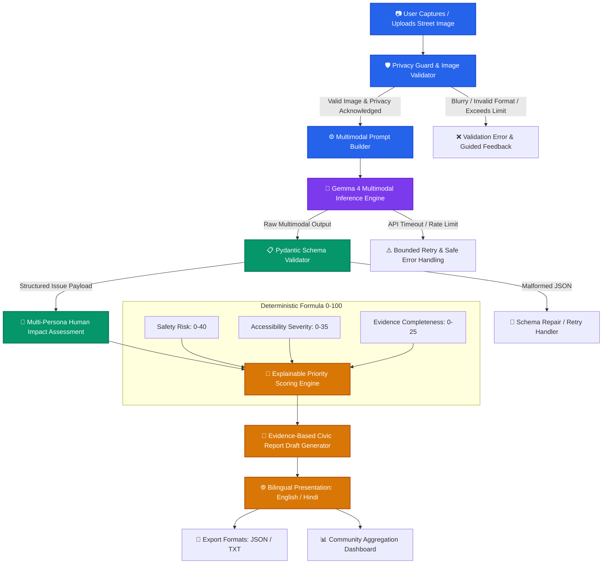
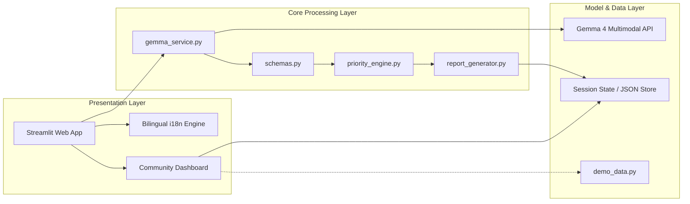

# 🏙️ CivicLens AI
### *A Multimodal Civic Accessibility Audit Prototype Powered by Gemma 4*

[](https://github.com/ashish-singh2004/hacktoberfest---civiclenceai)
[](#gemma-4-multimodal-integration)
[](#-united-nations-sdg-alignment)
[](#-united-nations-sdg-alignment)
[](#-united-nations-sdg-alignment)
[](#-united-nations-sdg-alignment)
[](https://www.python.org/)
[](https://streamlit.io/)

---

## 📌 Executive Summary & Project Goal

**CivicLens AI** is a community-driven civic accessibility audit tool designed to empower citizens, urban planners, and municipal advocates to document, evaluate, and report pedestrian and accessibility barriers in urban environments.

By utilizing the multimodal visual reasoning capabilities of **Gemma 4**, CivicLens AI analyzes ordinary street-level photographs to detect visible physical impediments (such as broken footpaths, missing curb ramps, waterlogging, open construction, and walkway encroachments). Rather than producing generic descriptions, the system:
1. **Differentiates direct visual observations from inferences.**
2. **Evaluates multidimensional human impacts** specifically tailored to vulnerable demographics (wheelchair users, visually impaired pedestrians, the elderly, and caregivers with strollers).
3. **Computes an explainable, deterministic priority score (0–100)** based on safety risk, accessibility obstruction, and evidence completeness.
4. **Drafts structured, evidence-based civic complaint reports** ready for export and voluntary submission to municipal authorities.
5. **Provides a bilingual user experience (English & Hindi)** to ensure accessibility across diverse communities.

> ⚠️ **Important Civic Clarification:** CivicLens AI is an assistive audit and drafting tool. It **never** automatically files complaints to government authorities without manual citizen review, nor does it claim to provide certified structural engineering inspections or legal compliance certifications.

---

## 🎯 United Nations SDG Alignment

CivicLens AI places the **United Nations Sustainable Development Goals (SDGs)** at the core of its mission, targeting tangible real-world solutions for inclusive and sustainable urban development:

```
┌────────────────────────────────────────────────────────────────────────────────────────┐
│                                UNITED NATIONS SDGs                                     │
├────────────────────┬────────────────────┬────────────────────┬─────────────────────────┤
│   🎯 SDG 11        │   🎯 SDG 10        │   🎯 SDG 9         │   🎯 SDG 3              │
│ Sustainable Cities │ Reduced            │ Industry, Innov.   │ Good Health             │
│ & Communities      │ Inequalities       │ & Infrastructure   │ & Well-being            │
│ (Target 11.2/11.7) │ (Target 10.2)      │ (Target 9.1)       │ (Target 3.6)            │
└────────────────────┴────────────────────┴────────────────────┴─────────────────────────┘
```

### 1. **SDG 11: Sustainable Cities and Communities**
- **Target 11.2:** Provide access to safe, affordable, accessible, and sustainable transport systems for all, expanding public transport with special attention to the needs of those in vulnerable situations, women, children, persons with disabilities, and older persons.
- **Target 11.7:** Provide universal access to safe, inclusive, accessible, green, and public spaces, particularly for persons with disabilities, the elderly, and children.
- **CivicLens Contribution:** Identifies non-motorized pedestrian transit hazards (broken sidewalks, missing tactile paving, sidewalk obstacles) to make urban micro-mobility inclusive and walkable.

### 2. **SDG 10: Reduced Inequalities**
- **Target 10.2:** Empower and promote the social, economic, and political inclusion of all, irrespective of age, sex, disability, race, ethnicity, origin, religion, or economic status.
- **CivicLens Contribution:** Amplifies the voice of marginalized mobility groups by translating raw photos into specific accessibility impact narratives for wheelchair users and visually impaired citizens.

### 3. **SDG 9: Industry, Innovation, and Infrastructure**
- **Target 9.1:** Develop quality, reliable, sustainable, and resilient infrastructure to support human well-being and equitable access.
- **CivicLens Contribution:** Bridges the data gap between grassroots street realities and municipal asset management systems using multimodal AI.

### 4. **SDG 3: Good Health and Well-being**
- **Target 3.6:** Halve the number of global deaths and injuries from road traffic accidents by eliminating pedestrian-vehicle friction caused by impassable sidewalks.

---

## 🔄 End-to-End Workflow & Architecture

### Complete System Workflow



### Component Architecture



---

## 🚀 Key Features

| Feature | Description | Implementation Details |
| :--- | :--- | :--- |
| **1. Privacy-First Ingestion** | Upload validation for JPG, JPEG, and PNG; visual quality checks; client-side photo deletion; face/plate masking warnings. | `Pillow`, MIME verification, no cloud persistence of raw photos. |
| **2. Real Gemma 4 Vision** | Zero synthetic hallucination. Sends street photos to Gemma 4 with structured prompts to identify physical obstructions. | `gemma_service.py` with bounded retry and timeout resilience. |
| **3. Pydantic Structured Output** | Guarantees strict JSON schema conformance for issues, evidence, affected groups, and confidence. | `schemas.py` using `pydantic.BaseModel` validation. |
| **4. Human-Impact Lens** | Tailored impact narratives for wheelchair users, visually impaired, elderly, and parents with strollers. | Evaluates direct vs. secondary physical risks per demographic. |
| **5. Explainable Priority Score** | Deterministic 0–100 formula combining safety impact, accessibility obstruction, and evidence certainty. | Transparent formula breakdown in `priority_engine.py`. |
| **6. Civic Report Drafter** | Generates formal, municipal-ready complaint drafts with user-supplied location and visual evidence quotes. | Editable text, copy-to-clipboard, TXT, and JSON export. |
| **7. Community Dashboard** | Group reports by category, severity, affected demographic, and verification status with duplicate flagging. | Interactive Plotly visual charts and filterable tables. |
| **8. Bilingual Accessibility** | Toggle interface and report explanations between English and Hindi (हिन्दी) seamlessly. | Internationalization string dictionary with native terms. |
| **9. Transparent Demo Mode** | Offline showcase mode utilizing clearly badged mock records for reliable hackathon presentation. | Hard-isolated from live Gemma inference with explicit UI tags. |

---

## 🧮 Explainable Priority Scoring Formula

Unlike opaque AI "black boxes", CivicLens AI computes priority deterministically using clear municipal weighting:

$$\text{Priority Score} = S_{\text{safety}} + A_{\text{accessibility}} + C_{\text{evidence}}$$

Where:
- **$S_{\text{safety}}$ (0 to 40 points):** Potential danger to life or physical injury (e.g., open trenches, exposed wiring, forcing pedestrians into high-speed vehicular traffic).
- **$A_{\text{accessibility}}$ (0 to 35 points):** Severity of obstruction to mobility-impaired individuals (e.g., complete impassability vs minor surface unevenness).
- **$C_{\text{evidence}}$ (0 to 25 points):** Confidence and completeness of visual evidence (e.g., clear lighting and unambiguous obstruction vs blurred/obscured angle).

### Priority Tiers:
- **80 – 100:** 🔴 **Critical Urgent** (Immediate safety hazard or complete barrier on arterial pedestrian route)
- **60 – 79:** 🟠 **High Priority** (Significant accessibility block; vulnerable groups forced into danger)
- **40 – 59:** 🟡 **Medium Priority** (Partial obstruction or degradation; alternate bypass feasible)
- **0 – 39:** 🟢 **Low / Routine Maintenance** (Cosmetic surface wear or minor localized defect)

---

## 🤖 Gemma 4 Multimodal Integration

This project is built specifically for the **Best Use of Gemma 4** track.

- **Multimodal Visual Reasoning:** Gemma 4 processes high-resolution street images alongside a structured system prompt.
- **Evidence Anchor:** Prompts explicitly require Gemma 4 to cite pixel-grounded visual indicators (e.g., *"concrete slab broken at 45-degree angle, exposing iron rebar"*) before classifying severity.
- **Uncertainty & Unknowns:** If an obstruction cannot be verified due to lighting, angle, or occlusion, Gemma 4 is instructed to flag `verification_required: true` and specify `unknowns`.
- **Configurable Provider:** Supports official Google GenAI / Vertex AI endpoints without hardcoded credentials.

---

## 📁 Repository Structure

```
Hacktoberfest-CivicLensAi/
│
├── .env.example             # Template for API keys and configuration
├── .gitignore               # Excludes secrets, cache, and virtualenvs
├── README.md                # Comprehensive documentation & setup guide
├── requirements.txt         # Pinned Python dependencies
│
├── app.py                   # Main Streamlit web application & UI
├── gemma_service.py         # Official Gemma 4 multimodal API interface
├── schemas.py               # Pydantic schemas for data validation
├── prompts.py               # Multimodal system & audit prompt templates
├── priority_engine.py       # Deterministic 0-100 priority scoring logic
├── report_generator.py      # Municipal civic complaint draft generator
├── demo_data.py             # Sample community records for offline demo
│
└── tests/
    ├── __init__.py
    ├── test_priority_engine.py   # Unit tests for deterministic scoring
    ├── test_schemas.py           # Unit tests for Pydantic schema validation
    └── test_gemma_service.py     # Mocked/live API integration tests
```

---

## 🛠️ Installation & Quickstart

### Prerequisites
- Python **3.10** or higher
- Git
- Valid Gemma 4 / Google Gemini API Key

### Step 1: Clone the Repository
```bash
git clone https://github.com/ashish-singh2004/hacktoberfest---civiclenceai.git
cd hacktoberfest---civiclenceai
```

### Step 2: Create a Virtual Environment
```bash
# Windows (PowerShell)
python -m venv .venv
.venv\Scripts\Activate.ps1

# Linux / macOS
python3 -m venv .venv
source .venv/bin/activate
```

### Step 3: Install Dependencies
```bash
pip install --upgrade pip
pip install -r requirements.txt
```

### Step 4: Configure Environment Variables
Copy the template file:
```bash
cp .env.example .env
```

Edit `.env` and set your configuration:
```env
# Official Gemma 4 / GenAI API Credentials
GEMMA_API_KEY=your_actual_api_key_here
GEMMA_MODEL_ID=gemma-4-multimodal-it
APP_ENV=development
ENABLE_DEMO_MODE=false
DEFAULT_LANGUAGE=en
```

### Step 5: Run the Streamlit Application
```bash
streamlit run app.py
```
Open your browser at `http://localhost:8501`.

---

## 🧪 Testing Guide

We maintain rigorous unit testing across data schemas, priority scoring math, and API error resilience:

```bash
# Run all tests
pytest tests/ -v

# Run priority engine tests with coverage
pytest tests/test_priority_engine.py -v --cov=priority_engine

# Run schema validation tests
pytest tests/test_schemas.py -v
```

### Test Coverage Highlights:
- ✅ Correct handling of clean, barrier-free pedestrian walkways (no false alarms).
- ✅ Rejection of malformed JSON responses from LLM endpoints.
- ✅ Boundary conditions for priority formula (scores strictly capped between 0 and 100).
- ✅ Missing API keys fail gracefully with human-friendly guidance.
- ✅ Offline fallback in Demo Mode without touching external networks.

---

## 🛡️ Responsible AI, Privacy & Ethics

1. **Facial & PII Protection:** The UI actively prompts users **not** to upload photos with recognizable human faces, vehicle license plates, or house numbers.
2. **No Demographic Profiling:** The model **never** attempts to identify or infer the personal characteristics, race, age, or disability status of any individual captured in an image.
3. **No Automated Submission:** To prevent spamming civic portals and maintain human accountability, reports are generated as **editable drafts only**. The user retains complete authority over if and where the report is submitted.
4. **Transparent Hallucination Safeguard:** The application explicitly flags assumptions and marks uncertain visual aspects for field inspection.

---

## ⚠️ Known Limitations

- **2D Image Constraints:** Ordinary monocular photographs cannot provide calibrated metric measurements (e.g., exact millimeter step height or slope angle).
- **Lighting & Weather:** Severe night-time darkness, heavy rain, or glare can obscure barriers; such images are flagged for manual verification.
- **Local Jurisdictional Differences:** Municipal building codes and sidewalk specifications vary across cities and countries; priority scores provide generalized relative urgency.

---

## 👥 Team & Hackathon Contributions

Built with ❤️ for **Hacktoberfest 2026**:
- **Akhilesh Yadav** ([@YaadavAkhilesh](https://github.com/YaadavAkhilesh)) — Multimodal AI Pipeline, Gemma 4 Integration, Priority Scoring Engine & Backend Architecture.
- **Ashish Singh** ([@ashish-singh2004](https://github.com/ashish-singh2004)) — Product Design, Streamlit Frontend, Bilingual (Hindi/English) Localization & Community Dashboard.

---

## 📄 License

This project is licensed under the [MIT License](LICENSE).
